<!-- Generated from benchmark-results/latest.json. Run `pnpm turbo run generate-performance --filter=docs` to update. -->

These benchmarks compare QRCodeSDK with other JavaScript QR code libraries:

| Benchmark                                    | Compared with                                                 |
| -------------------------------------------- | ------------------------------------------------------------- |
| Matrix, automatic matrix, and SVG generation | `qrcode`, and `qrcode-generator` using its stock text encoder |
| Styled SVG generation                        | `qr-code-styling`                                             |

Each chart shows throughput calculated from the median time. Higher is better, and the fastest library comes first. Expand the exact benchmark data below each section for median time, min–max range, and throughput.

Results depend on the machine and runtime. Compare the libraries with each other, not with absolute speeds.

## Method

- The matrix and SVG fixtures supply explicit versions and masks.
- The `qrcode-generator` rows use a repository patch that applies each fixture's mask and skips automatic mask evaluation.
- The automatic matrix fixtures omit both options, so every library selects the version and mask itself.
- Styled SVG generation uses all 60 shared styling fixtures at 1, 10, and 50 repetitions.
- Both styled SVG libraries select the mask automatically, because `qr-code-styling` has no public mask option.
- Each fixture's module size and margin set the pixel dimensions passed to `qr-code-styling`. It renders SVG through a shared JSDOM environment that is set up before measurement.

## Benchmark environment

- Generated: `2026-11-06T15:06:18.076Z`
- Runtime: `v26.13.0` on `darwin arm64`
- CPU: `Apple M2 Pro` (12 logical cores)
- Libraries: `qrcodesdk@0.0.5`, `qrcode@1.5.4`, `qrcode-generator@2.0.4`, `qr-code-styling@1.9.2`
- Samples: 3 timed samples after 5 static warm-up passes and 1 exhaustive warm-up pass
- SVG output: 4 px/module with a 4-module quiet zone
- Styled SVG fixtures: 60, with fixture-derived dimensions and automatic mask selection

## Matrix generation

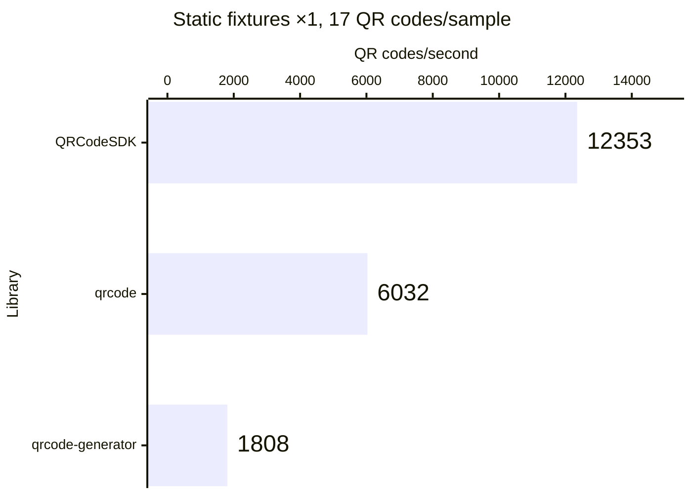

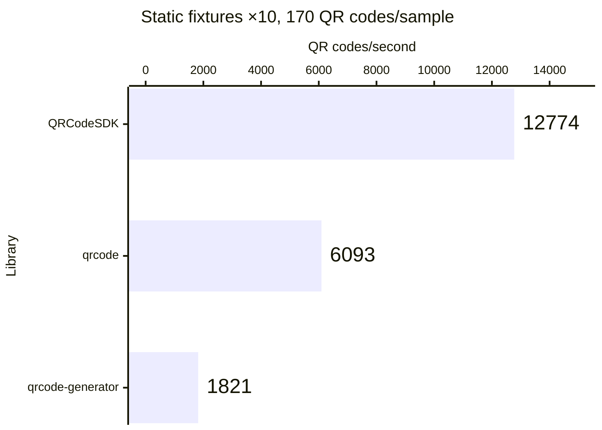

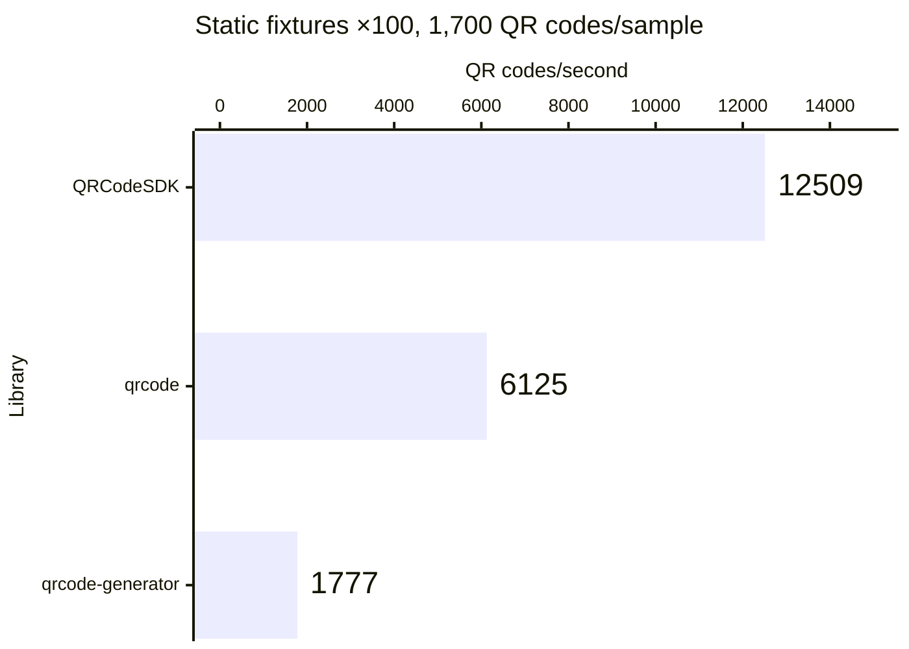

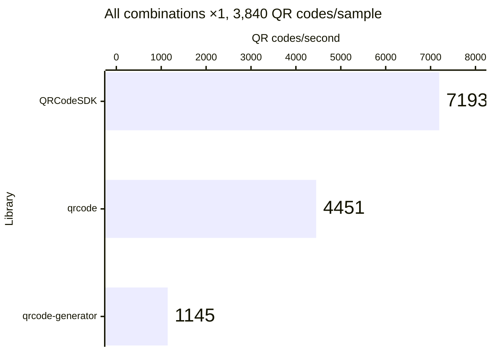

Exact benchmark data

| Workload             | QR codes/sample | Library                 | Median (ms) |      Min–max (ms) | QR codes/second |
| -------------------- | --------------: | ----------------------- | ----------: | ----------------: | --------------: |
| Static fixtures ×1   |              17 | QRCodeSDK v0.0.5        |       1.376 |       1.336–1.458 |          12,353 |
| Static fixtures ×1   |              17 | qrcode v1.5.4           |       2.818 |       2.804–2.825 |           6,032 |
| Static fixtures ×1   |              17 | qrcode-generator v2.0.4 |       9.403 |       9.389–9.613 |           1,808 |
| Static fixtures ×10  |             170 | QRCodeSDK v0.0.5        |      13.308 |     13.266–13.565 |          12,774 |
| Static fixtures ×10  |             170 | qrcode v1.5.4           |      27.900 |     27.524–33.000 |           6,093 |
| Static fixtures ×10  |             170 | qrcode-generator v2.0.4 |      93.335 |     92.926–93.705 |           1,821 |
| Static fixtures ×100 |           1,700 | QRCodeSDK v0.0.5        |     135.907 |   135.241–138.836 |          12,509 |
| Static fixtures ×100 |           1,700 | qrcode v1.5.4           |     277.540 |   276.390–278.996 |           6,125 |
| Static fixtures ×100 |           1,700 | qrcode-generator v2.0.4 |     956.870 |   949.522–961.370 |           1,777 |
| All combinations ×1  |           3,840 | QRCodeSDK v0.0.5        |     533.857 |   515.417–542.774 |           7,193 |
| All combinations ×1  |           3,840 | qrcode v1.5.4           |     862.814 |   862.372–864.768 |           4,451 |
| All combinations ×1  |           3,840 | qrcode-generator v2.0.4 |    3352.721 | 3323.766–3380.075 |           1,145 |

## Automatic matrix generation

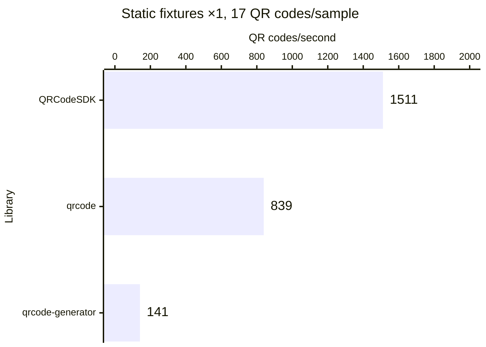

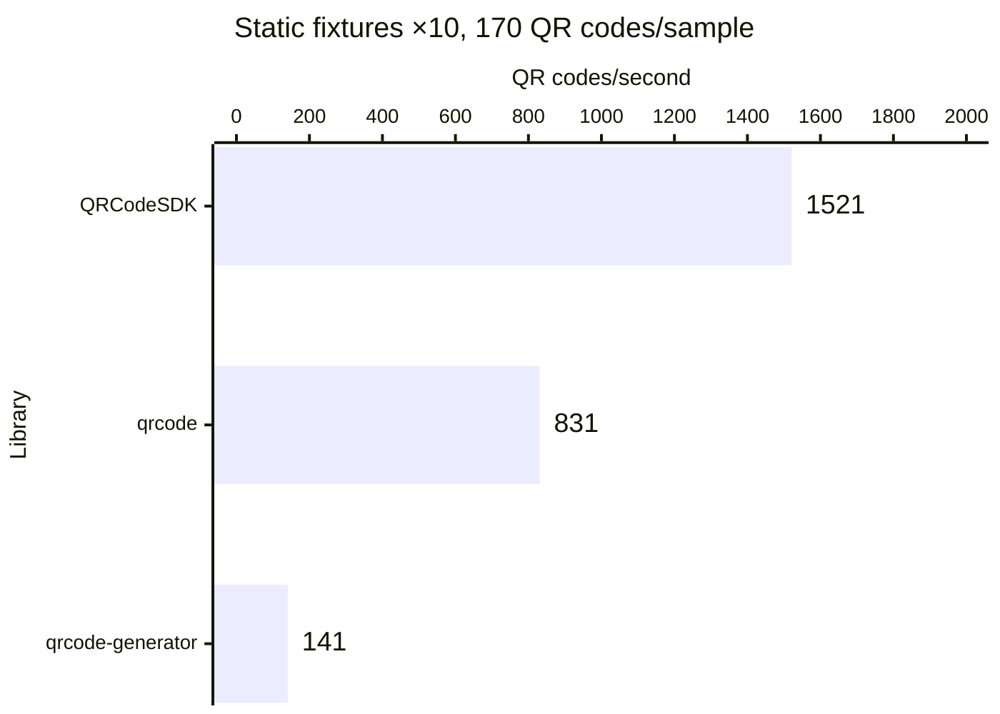

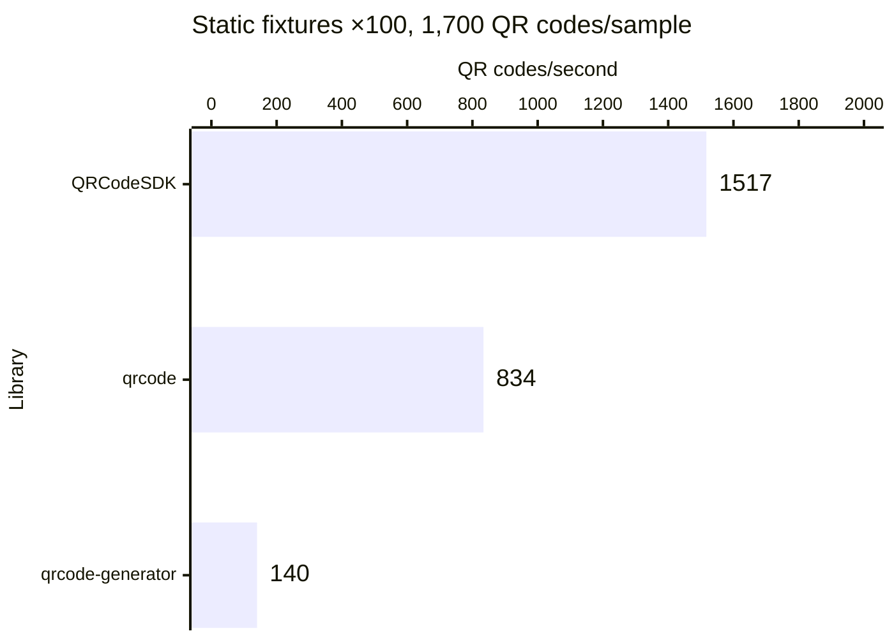

Exact benchmark data

| Workload             | QR codes/sample | Library                 | Median (ms) |        Min–max (ms) | QR codes/second |
| -------------------- | --------------: | ----------------------- | ----------: | ------------------: | --------------: |
| Static fixtures ×1   |              17 | QRCodeSDK v0.0.5        |      11.248 |       11.240–11.526 |           1,511 |
| Static fixtures ×1   |              17 | qrcode v1.5.4           |      20.265 |       20.196–20.279 |             839 |
| Static fixtures ×1   |              17 | qrcode-generator v2.0.4 |     120.454 |     120.431–120.488 |             141 |
| Static fixtures ×10  |             170 | QRCodeSDK v0.0.5        |     111.802 |     111.493–111.988 |           1,521 |
| Static fixtures ×10  |             170 | qrcode v1.5.4           |     204.607 |     204.469–213.226 |             831 |
| Static fixtures ×10  |             170 | qrcode-generator v2.0.4 |    1204.640 |   1203.003–1205.786 |             141 |
| Static fixtures ×100 |           1,700 | QRCodeSDK v0.0.5        |    1120.414 |   1116.191–1121.307 |           1,517 |
| Static fixtures ×100 |           1,700 | qrcode v1.5.4           |    2039.085 |   2031.386–2045.479 |             834 |
| Static fixtures ×100 |           1,700 | qrcode-generator v2.0.4 |   12113.033 | 12086.387–12114.542 |             140 |

## SVG generation

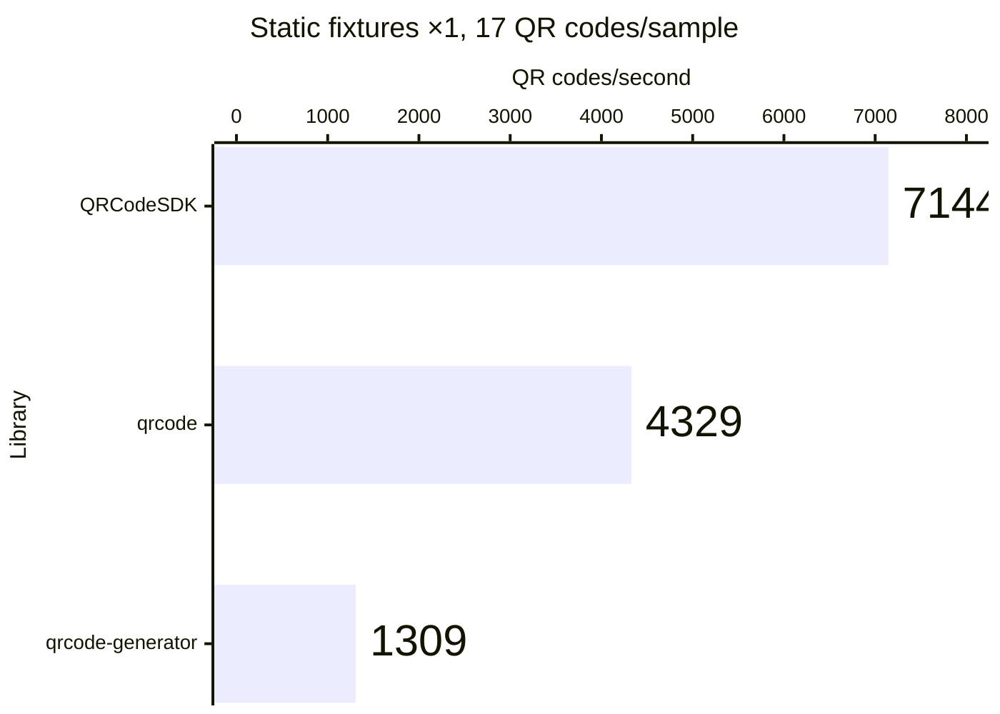

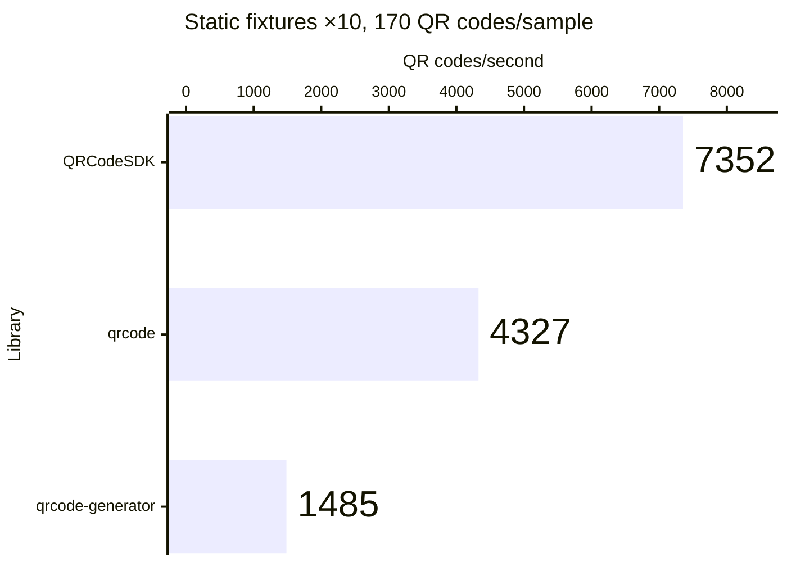

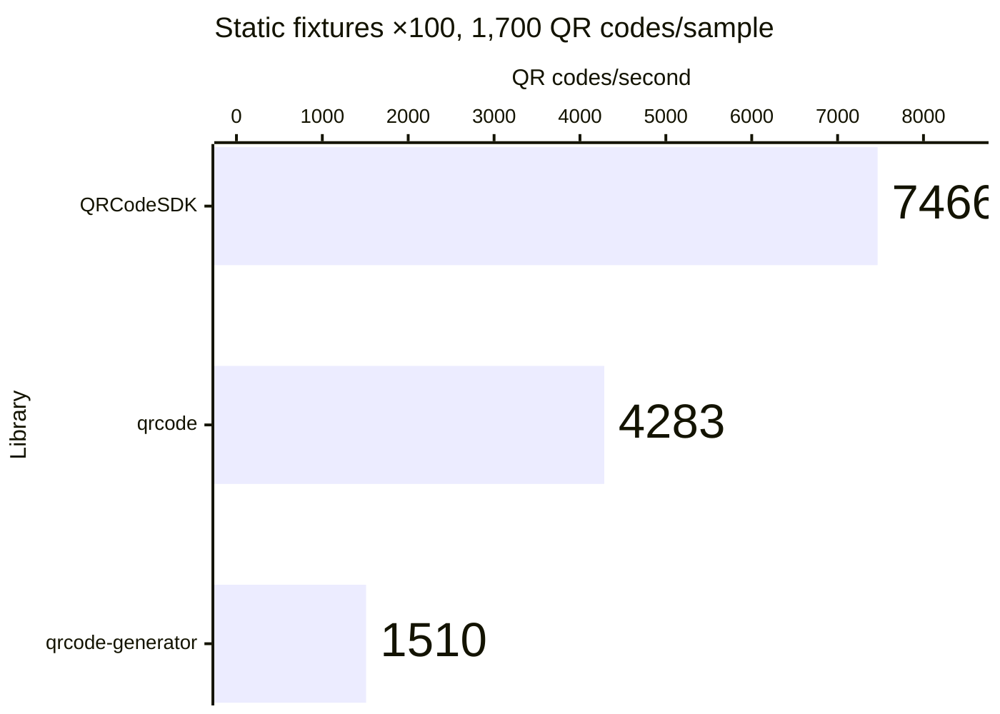

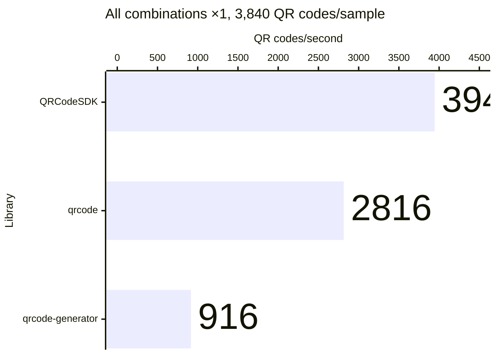

Exact benchmark data

| Workload             | QR codes/sample | Library                 | Median (ms) |      Min–max (ms) | QR codes/second |
| -------------------- | --------------: | ----------------------- | ----------: | ----------------: | --------------: |
| Static fixtures ×1   |              17 | QRCodeSDK v0.0.5        |       2.380 |       2.362–2.677 |           7,144 |
| Static fixtures ×1   |              17 | qrcode v1.5.4           |       3.927 |       3.913–4.051 |           4,329 |
| Static fixtures ×1   |              17 | qrcode-generator v2.0.4 |      12.987 |     11.597–19.792 |           1,309 |
| Static fixtures ×10  |             170 | QRCodeSDK v0.0.5        |      23.124 |     22.585–23.777 |           7,352 |
| Static fixtures ×10  |             170 | qrcode v1.5.4           |      39.288 |     38.973–39.675 |           4,327 |
| Static fixtures ×10  |             170 | qrcode-generator v2.0.4 |     114.452 |   113.475–115.447 |           1,485 |
| Static fixtures ×100 |           1,700 | QRCodeSDK v0.0.5        |     227.684 |   227.588–231.643 |           7,466 |
| Static fixtures ×100 |           1,700 | qrcode v1.5.4           |     396.909 |   392.837–400.510 |           4,283 |
| Static fixtures ×100 |           1,700 | qrcode-generator v2.0.4 |    1125.867 | 1121.152–1140.295 |           1,510 |
| All combinations ×1  |           3,840 | QRCodeSDK v0.0.5        |     973.162 |   969.485–973.321 |           3,946 |
| All combinations ×1  |           3,840 | qrcode v1.5.4           |    1363.541 | 1355.323–1372.737 |           2,816 |
| All combinations ×1  |           3,840 | qrcode-generator v2.0.4 |    4191.436 | 4184.521–4199.740 |             916 |

## Styled SVG generation

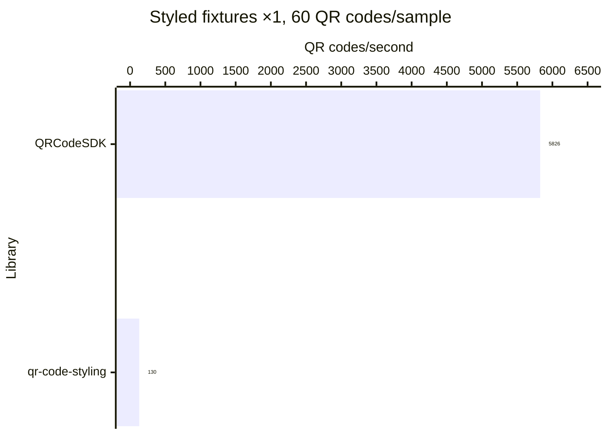

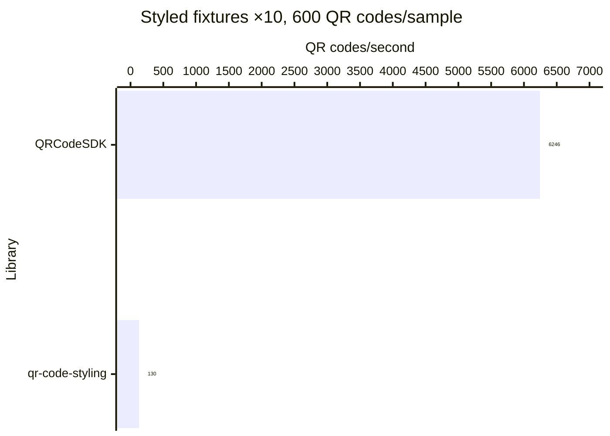

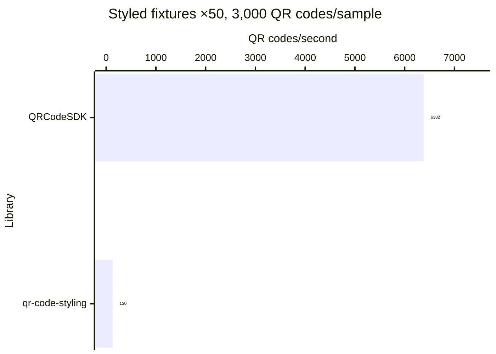

Exact benchmark data

| Workload            | QR codes/sample | Library                | Median (ms) |        Min–max (ms) | QR codes/second |
| ------------------- | --------------: | ---------------------- | ----------: | ------------------: | --------------: |
| Styled fixtures ×1  |              60 | QRCodeSDK v0.0.5       |      10.298 |        9.634–10.370 |           5,826 |
| Styled fixtures ×1  |              60 | qr-code-styling v1.9.2 |     460.030 |     459.573–464.297 |             130 |
| Styled fixtures ×10 |             600 | QRCodeSDK v0.0.5       |      96.065 |       95.987–97.787 |           6,246 |
| Styled fixtures ×10 |             600 | qr-code-styling v1.9.2 |    4611.193 |   4608.296–4649.144 |             130 |
| Styled fixtures ×50 |           3,000 | QRCodeSDK v0.0.5       |     470.044 |     469.335–471.631 |           6,382 |
| Styled fixtures ×50 |           3,000 | qr-code-styling v1.9.2 |   23139.940 | 23042.060–23307.815 |             130 |

